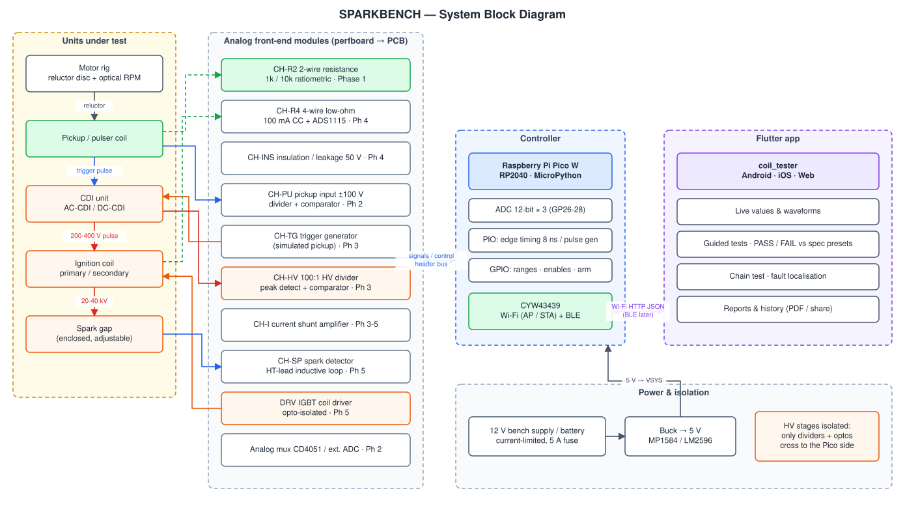

# Bike Coils Tester

A bench tester for motorcycle **pickup coils**, **AC/DC CDI units** and **ignition coils**. It tests
each part on its own, or the whole chain from pickup to spark, and reports which part failed.
It's built around a Raspberry Pi Pico W and a Flutter app (Android / iOS / Web) over Wi-Fi.

> ⚠️ Ignition systems produce lethal voltages. Read [docs/safety.md](docs/safety.md) first.

| Start here | |
|---|---|
| [docs/test-plan.md](docs/test-plan.md) | What gets tested and how, with pass/fail criteria |
| [docs/architecture.md](docs/architecture.md) | Channels, pin map, API |
| [docs/roadmap.md](docs/roadmap.md) | Phases; current = **Phase 1: Wi-Fi + resistance** |
| [hardware/circuits/ch-r2-resistance.md](hardware/circuits/ch-r2-resistance.md) | Phase 1 circuit to build on perfboard |
| [hardware/bom.md](hardware/bom.md) | Parts list |
| [firmware/README.md](firmware/README.md) | Flash and deploy the Pico W |
| [app/README.md](app/README.md) | Set up and run the Flutter app |

Diagrams (`hardware/diagrams/*.drawio.svg`) open directly in draw.io for editing.
