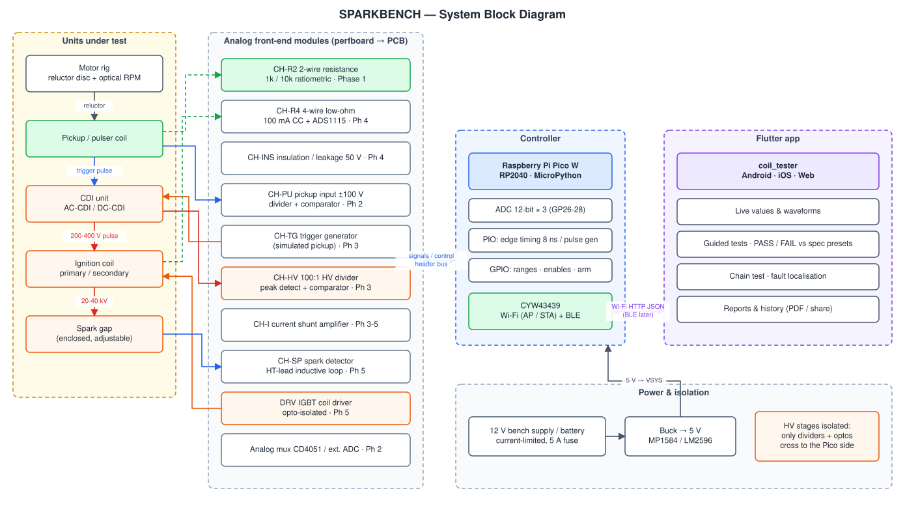

# Architecture

Block diagram: [`hardware/diagrams/system-block-diagram.drawio.svg`](../hardware/diagrams/system-block-diagram.drawio.svg)



## Layers

1. **Units under test (UUT):** pickup coil, CDI (AC/DC), ignition coil + spark gap; optional motor
   rig with a reluctor disc.
2. **Analog front-end (AFE):** one block per measurement channel, each on its own perfboard
   module at first (easy to debug and replace). They connect to the Pico board through a common
   header: 3V3, 5V, GND, signals.
3. **Pico W controller:** RP2040 ADC (12-bit, 500 kS/s shared), PIO for µs-accurate edge timing and
   trigger generation, GPIO for range/arm switching, CYW43439 for Wi-Fi/BLE.
4. **Transport:** Wi-Fi HTTP JSON (Phase 1). WebSocket streaming for waveforms (Phase 3).
   BLE GATT (Phase 7).
5. **App (Flutter):** connect, live values, guided test sequences, PASS/FAIL against spec
   presets, reports.

## Measurement channels

| Channel | Purpose | Circuit block | Pico resources | Phase |
|---|---|---|---|---|
| CH-R2 | 2-wire resistance 20 Ω – 200 kΩ (P1, I2) | Ratiometric divider, 1 k / 10 k ranges. Perfboard: Pico ADC0-2. **PCB (proposed): ADS1115**, see `hardware/circuits/ch-r2-pcb.md` | GP14, GP15 (+ I²C on the PCB) | **1** |
| CH-R4 | 4-wire low ohm 0.05 – 10 Ω (I1) | LM317 100 mA CC source + ADS1115 (I²C) | I2C0 GP4/GP5, GP13 enable | 4 |
| CH-INS | Insulation / leakage (P3, I3) | 50 V boost (nixie-type HV module) + 1 MΩ sense + ADS1115 | ADS1115 ch, GP12 enable | 4 |
| CH-PU | Pickup signal input ±100 V (P4–P6) | Fixed HV divider + 3 switched ranges + 1.65 V bias → buffer → ADC; dual comparator → PIO. **Proposed:** see `hardware/circuits/ch-pu-pickup.md`, pins in `docs/pin-budget.md` | GP26, GP2, GP3, SPI0 | 2 |
| CH-TG | Trigger generator (simulated pickup) | PWM → RC → TL072 bipolar driver ±5 V | GP17 / GP18 | 3 |
| CH-HV | CDI output / coil flyback 0 – 500 V | 100:1 HV divider, peak detector with reset, comparator → PIO | ADC1 (muxed), GP19, GP20 | 3 |
| CH-I | Primary / supply current | 10 mΩ shunt + LM358 gain stage | ADC2 (muxed) | 3–5 |
| CH-SP | Spark detection | HT-lead inductive loop → RC → LM393 → PIO | GP21 | 5 |
| DRV | Coil driver (TCI dwell) | Opto (6N137) → ignition IGBT (ISL9V3040 / BU941ZP) | GP22 + arm switch | 5 |
| RIG | Motor + optical RPM sensor | PWM motor driver + TCRT5000/slot sensor | GP10, GP11 | 2 (optional) |

The Pico has only three usable ADC inputs (GP26-28), so from Phase 2 on the analog channels go
through a **CD4051 analog mux** or an external ADS1115. That decision gets made at Phase 2.

## Pin map (Phase 1)

Source of truth: `firmware/src/hw_pins.py`.

| Pin | Function |
|---|---|
| GP26 / ADC0 | CH-R2 node (DUT+), via 1 kΩ series + BAT54S clamp |
| GP27 / ADC1 | CH-R2 top of 1 kΩ reference |
| GP28 / ADC2 | CH-R2 top of 10 kΩ reference |
| GP14 | CH-R2 drive, 1 kΩ range (output high = active, input = off) |
| GP15 | CH-R2 drive, 10 kΩ range |
| LED (WL_GPIO0) | Status: blinking = connecting, solid = ready |

## Data protocol — HTTP JSON (`/api/v1`)

The device runs an HTTP server on port 80. Every response is JSON and includes CORS headers, so the
Flutter **web** build can call it.

| Method | Path | Response |
|---|---|---|
| GET | `/api/v1/info` | `{device, fw_version, ip, mode, uptime_s, lead_ohms}` |
| GET | `/api/v1/resistance?range=auto\|1k\|10k` | Resistance result (below) |
| POST | `/api/v1/calibrate/zero` | Measures with clips shorted, stores the lead offset → `{ok, lead_ohms}` |
| GET | `/` | Small HTML page for a quick check from any browser |

Resistance result:

```json
{
  "ok": true,
  "status": "ok",          // ok | open | short | over_range
  "ohms": 152.3,           // lead offset already subtracted; null if open
  "raw_ohms": 152.7,
  "range": "1k",
  "v_top": 3.212,
  "v_node": 0.418,
  "lead_ohms": 0.4,
  "samples": 64,
  "t_ms": 123456
}
```

Errors: `{"ok": false, "error": "message"}` with HTTP 4xx/5xx.

## Wi-Fi modes

- **AP mode (default):** Pico creates the network `CoilTester` (password in `wifi_config.py`) and
  is reachable at `192.168.4.1`. Works anywhere, including a garage with no router.
- **STA mode:** Pico joins your Wi-Fi network. It falls back to AP mode if it can't connect within
  15 s. The IP is printed on the USB serial console.

## Power

12 V bench supply / battery → fuse → buck converter (MP1584 / LM2596 module) → 5 V → Pico VSYS
(through a Schottky diode so USB and VSYS can both be connected). From Phase 3 on, the Pico side
stays electrically separate from the HV stages, apart from the defined divider/opto paths. See
`docs/safety.md`.
